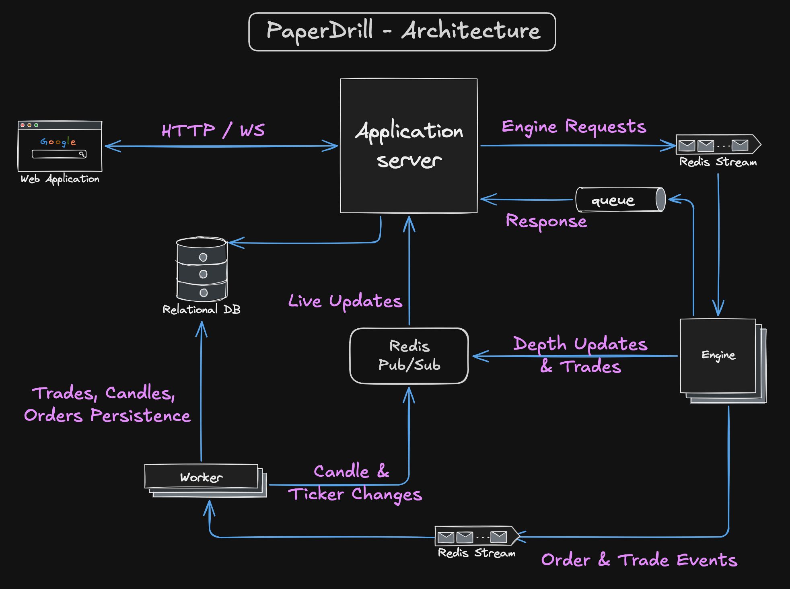

  <h1>PaperDrill</h1>
  
<strong>Competitive trading, powered by a real matching engine.</strong>

  

    
    
    
    
    
  

  

    <a href="https://paperdrill.dev">Platform</a> ·
    <a href="https://docs.paperdrill.dev">API documentation</a> ·
    <a href="https://api.paperdrill.dev">API</a>
  

PaperDrill is a competitive trading platform built around credit markets, a real matching engine, and a public leaderboard. Trade through the web interface or connect a bot through the API, build a measurable record, and compete without risking capital.

## Features

- **Live matching engine** — price-time priority matching rather than mocked fills.
- **Real-time market data** — order book, trades, tickers, and updating candles over WebSocket.
- **Persistent accounts** — credit balances, open orders, order history, and trade history.
- **Public leaderboard** — compare portfolio performance with other traders.
- **Scoped API keys** — programmable account access and order management.
- **Bot-friendly API** — REST trading endpoints and public WebSocket feeds.
- **Daily credit** — idempotent recurring credit with an adjustable PnL baseline.

## Architecture

| Service    | Responsibility                                                              |
| ---------- | --------------------------------------------------------------------------- |
| `frontend` | React SPA for markets, trading, account management, and leaderboard         |
| `docs`     | Mintlify site for product guides and API documentation                      |
| `backend`  | Express REST/WebSocket API, authentication, validation, and market metadata |
| `engine`   | In-memory balances, order books, matching, and periodic snapshots           |
| `worker`   | Persists orders/fills/balances and derives candles and tickers              |
| `bot`      | Optional market makers for the supported markets                            |
| PostgreSQL | Accounts, markets, orders, fills, candles, credits, and leaderboard data    |
| Redis      | Commands, responses, event streams, pub/sub, and runtime checkpoints        |

Backend, engine, and worker communicate through Redis. Production uses an external PostgreSQL provider; Redis and engine snapshots use persistent Docker volumes, with nginx running on the application host.

## Tech Stack

| Layer          | Technology                                |
| -------------- | ----------------------------------------- |
| Runtime        | Bun + TypeScript                          |
| Frontend       | React 19, Tailwind CSS 4, TanStack Query  |
| API            | Express 5, WebSocket (`ws`), Zod          |
| Data           | PostgreSQL/TimescaleDB, Prisma 7, Redis 7 |
| Observability  | Structured service logs, Sentry, PostHog  |
| Infrastructure | Docker Compose, nginx, GHCR, Cloudflare   |
